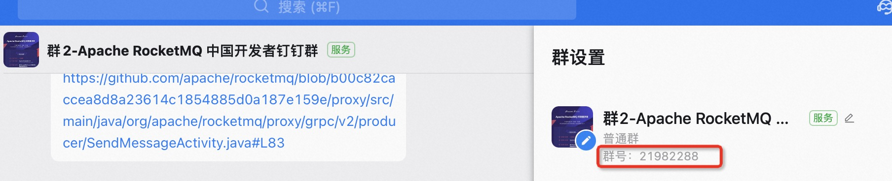

# 参与社区

## 1. 关注 Apache RocketMQ 微信公众号

- **微信公众号：rocketmqcc**
  

- **钉钉群号：21982288**
  

## 2. 阅读 Apache RocketMQ 博客

- 更新日志 [➡️](/release-notes)
- 社区活动 [➡️](/events)
- 用户案例 [➡️](/blog)

## 3. 订阅 Apache RocketMQ 邮件列表 📮

| 名称 | 说明 | 订阅 | 退订 | 归档 |
| :--- | :--- | :--- | :--- | :--- |
| 用户列表 | 用户支持与问题讨论 | [订阅](mailto:users-subscribe@rocketmq.apache.org) | [退订](mailto:users-unsubscribe@rocketmq.apache.org) | [邮件归档](https://lists.apache.org/list.html?users@rocketmq.apache.org) |
| 开发列表 | 开发相关讨论 | [订阅](mailto:dev-subscribe@rocketmq.apache.org) | [退订](mailto:dev-unsubscribe@rocketmq.apache.org) | [邮件归档](https://lists.apache.org/list.html?dev@rocketmq.apache.org) |
| 提交列表 | 仓库提交记录 | [订阅](mailto:commits-subscribe@rocketmq.apache.org) | [退订](mailto:commits-unsubscribe@rocketmq.apache.org) | [邮件归档](https://lists.apache.org/list.html?commits@rocketmq.apache.org) |
